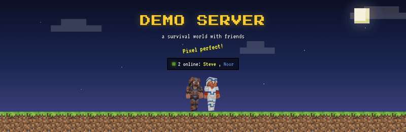
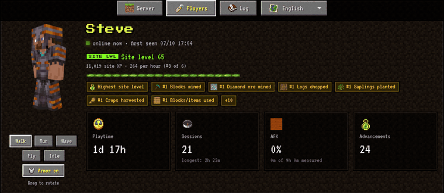
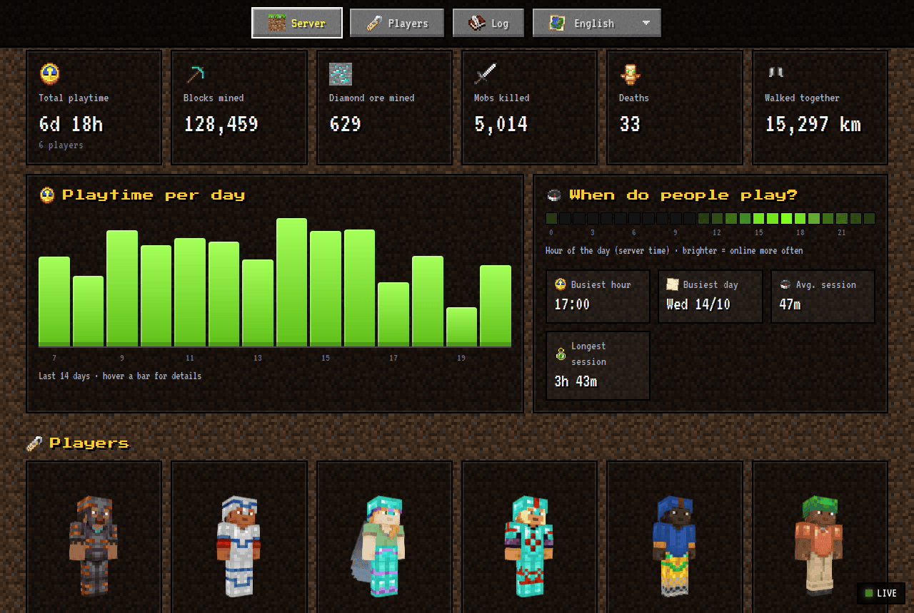
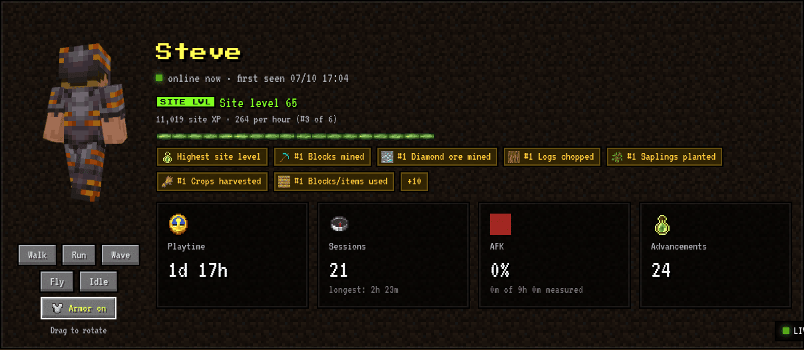
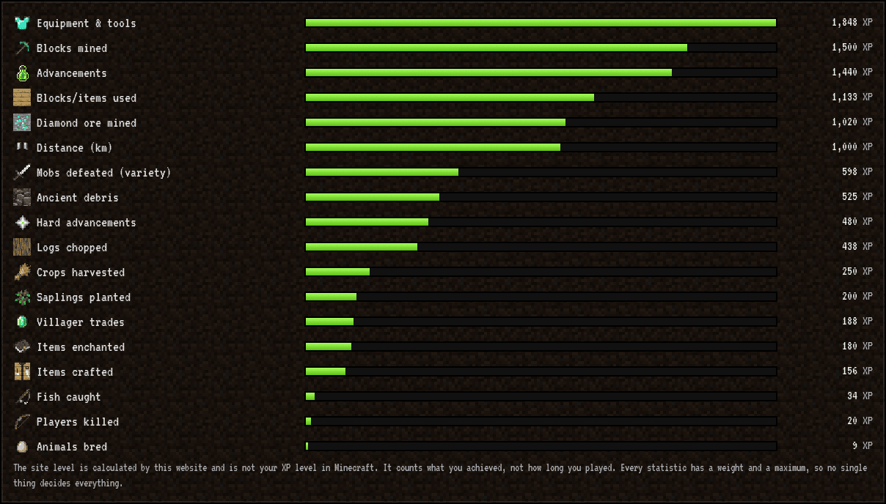
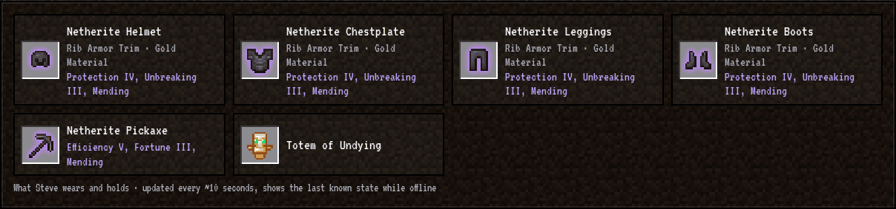
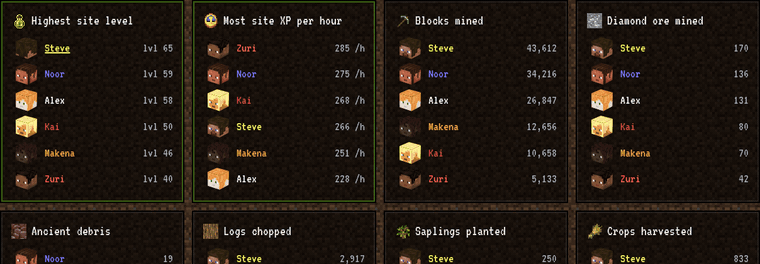
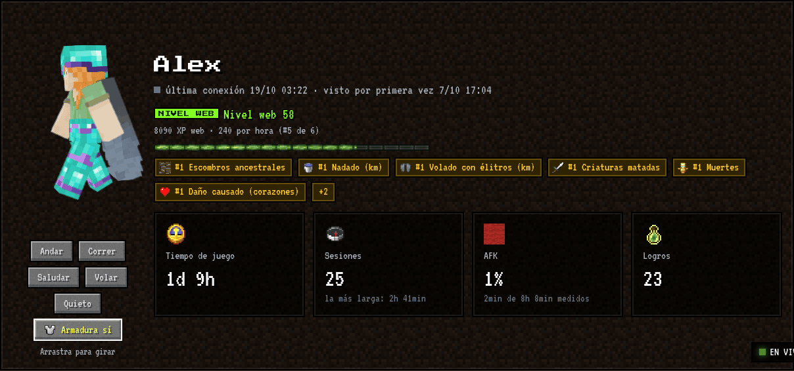
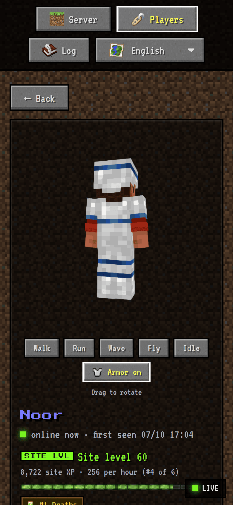

<div align="center">

# ⛏ mc-server-stats

**A live statistics website for your Minecraft server, styled like Minecraft itself.**

3D players in the armor they actually wear, leaderboards, playtime charts, AFK tracking and a level for what you achieved.
Made for a fun survival server with your friends. No plugins, no mods: one command to install.



[Features](#features) · [Screenshots](#screenshots) · [Install](#installation) · [Try the demo](#try-the-demo) · [Configuration](#configuration)

   

</div>

## Features

- **Live**: the page updates itself every 5 seconds: who's online, joins, deaths, advancements, equipment.
- **3D players** ([skinview3d](https://github.com/bs-community/skinview3d)) with their skin, active **cape**, and the
  **armor they're wearing**, including dyed leather, **armor trims** with the real color palettes and elytras. Drag to rotate, pick an animation.
- **Per player**: playtime per day and per hour of the day, sessions, equipment with enchantments, ~30 statistics with ranks,
  a timeline of advancements and deaths, and #1 badges.
- **Site level**: XP for advancements, diamonds, ancient debris, building, variety of mobs defeated, gear, … with weights and caps
  so farming one thing doesn't decide everything. Uses Minecraft's own XP formula. Also ranks *XP per hour*.
- **Leaderboards** for every statistic, with spinning 3D heads.
- **AFK meter**: a datapack that measures every second whether a player moves, looks around or does something.
- **Log**: commands, operator history (who was ever op, admin commands with and without rights), whitelist/bans, warnings.
- **Multilingual**: English, Nederlands, Español, Deutsch, Français. Item, mob, enchantment, trim and advancement names and even
  death messages come from Minecraft's official translations.
- **Real Minecraft look**: dirt background, buttons, XP bar, advancement frames and item icons from the game.

### Privacy by design
Private messages (`/msg`, `/tell`, …) are never shown, IP addresses are never read, coordinates in commands are hidden
(`/tp [x y z]`) and inventories are only used to calculate the level, never published. The log tab can be turned off.

## Screenshots

<div align="center">

**Every player in 3D, wearing their real armor, trims and capes.** Drag to rotate, pick an animation.



**The home page:** totals, playtime per day, when people play and everyone who plays.



**A site level for what you achieved,** not for how long you were online.





**Equipment** with enchantments and armor trims, in the names of your language.



**Leaderboards** for everything, with spinning 3D heads.



**In your language, and on your phone.**

 

</div>

## Try the demo

Want to see it first? The demo shows a made-up server, no Minecraft server needed:

```bash
git clone https://github.com/kylianxdev/mc-server-stats.git && cd mc-server-stats
python3 scripts/fetch_assets.py --version 1.21.10
python3 -m mcstats --demo     # open http://localhost:8200
```

## Requirements

- A Minecraft Java server, 1.21.5 or newer (tested with 26.3, Paper)
- Python 3.11+ (no extra packages needed)
- Read access to the server folder

## Installation

On the machine that runs your Minecraft server:

```bash
curl -fsSL https://raw.githubusercontent.com/kylianxdev/mc-server-stats/main/install.sh | bash
```

The installer finds your server, writes `config.toml`, downloads the textures, installs the datapacks, offers live
equipment updates on Paper and sets up a service that starts automatically. It asks before changing anything;
add `--yes` to accept all defaults. Afterwards open `http://your-server:8200`.

Update later with `~/mc-server-stats/install.sh --update`. All options: `install.sh --help`.

<details>
<summary>Manual installation</summary>

```bash
git clone https://github.com/kylianxdev/mc-server-stats.git
cd mc-server-stats
cp config.example.toml config.toml        # set minecraft.dir to your server folder
python3 scripts/fetch_assets.py --config config.toml
python3 -m mcstats --config config.toml   # http://your-server:8200
```

`fetch_assets.py` downloads the official Minecraft client for your server's version (checksum verified) and extracts the
textures and translations the website needs. Minecraft's assets belong to Mojang, so they're not part of this repository.
Run it again after updating Minecraft (`install.sh --update` does this for you).
</details>

### Datapacks (recommended)

Copy the folders from `datapacks/` into `<server>/world/datapacks/` and run `/reload` (pretty-chat needs a restart):

| Datapack | What it does |
|---|---|
| `afk-meter` | Measures AFK time every second (needed for the AFK numbers) |
| `armor-colors` | Players' name color follows their armor trim, otherwise their chestplate (in chat, tab list and above their head) |
| `pretty-chat` | `<Steve> hi` becomes **Steve** » hi |

The `pack.mcmeta` files are made for pack format 121 (Minecraft 26.x). For other versions, change `min_format`/`max_format`.

### Real-time equipment (Paper)

Player files are normally saved every 5 minutes. To see armor changes within seconds, set in `config/paper-global.yml`:

```yaml
player-auto-save:
  max-per-tick: 2
  rate: 200   # every 10 seconds; only player files, cheap
```

### Run as a service

See `deploy/mc-server-stats.service` (systemd). To serve it on port 80/443, put it behind a reverse proxy such as Caddy or nginx.

## Configuration

Everything is in `config.toml`. See [`config.example.toml`](config.example.toml): the server folder, port, site title,
languages, privacy options and the AFK threshold.

## Extras

`extras/` contains optional scripts that work well with the website: a world **backup** that warns players in chat
(`backup.sh`), a **chat announcement** with a clickable link to the website (`announce.sh`), and a helper that gives the
BlueMap plugin a lower CPU priority (`renice-bluemap.sh`).

## Translations

Website texts live in `web/i18n/<language>.json`. To add a language: copy `en.json`, translate it, add the code to
`languages` in your config, and (if it's a new Minecraft language) to `LANG_CODES` in `scripts/fetch_assets.py`.

## Development

```bash
python3 -m unittest discover -s tests -t .
```

```
mcstats/      Python backend: logs, statistics, site level, scoreboard, skins, HTTP server
web/          the website: index.html, css/, js/ (ES modules), i18n/
datapacks/    afk-meter, armor-colors, pretty-chat
scripts/      fetch_assets.py
extras/       optional helper scripts
deploy/       systemd service
tests/        unit tests
```

## License

MIT, see [LICENSE](LICENSE). Not an official Minecraft product; not approved by or associated with Mojang or Microsoft.
